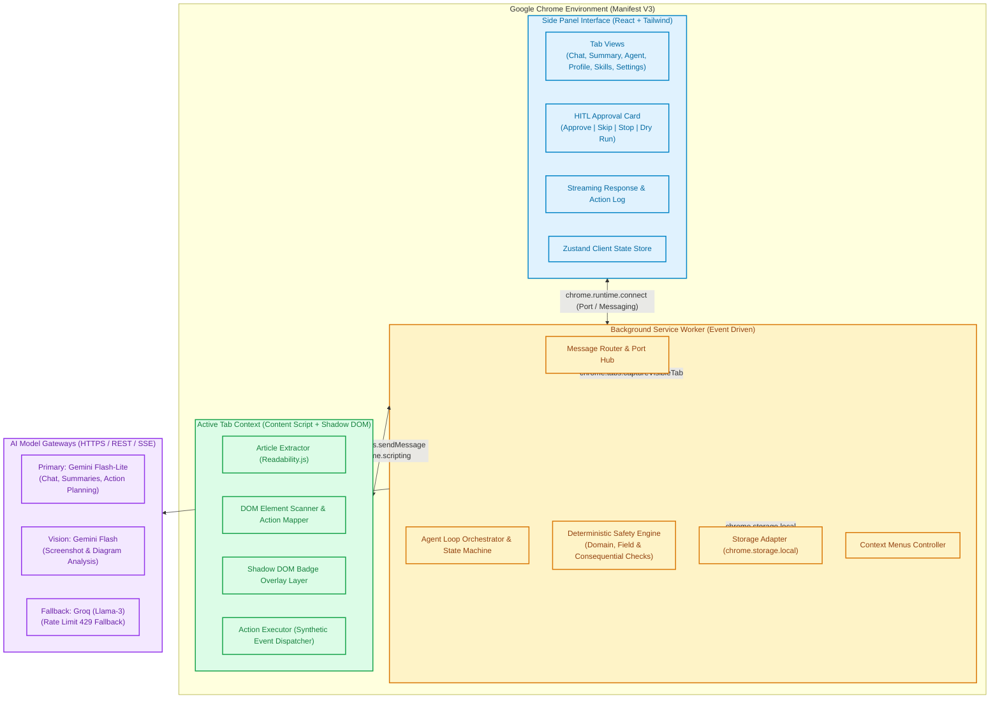
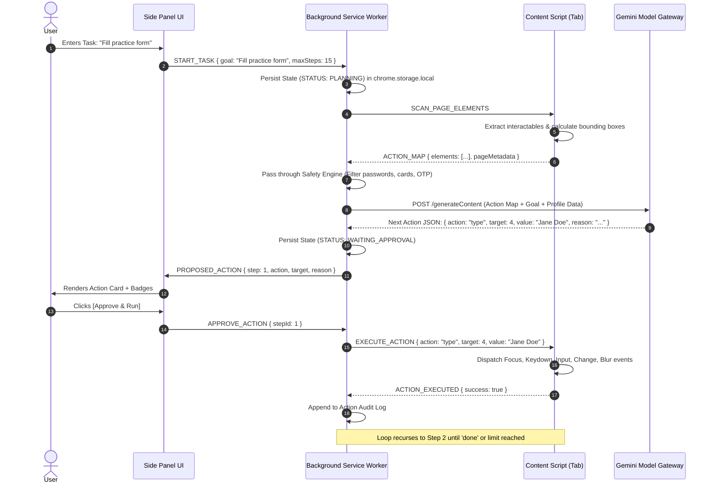
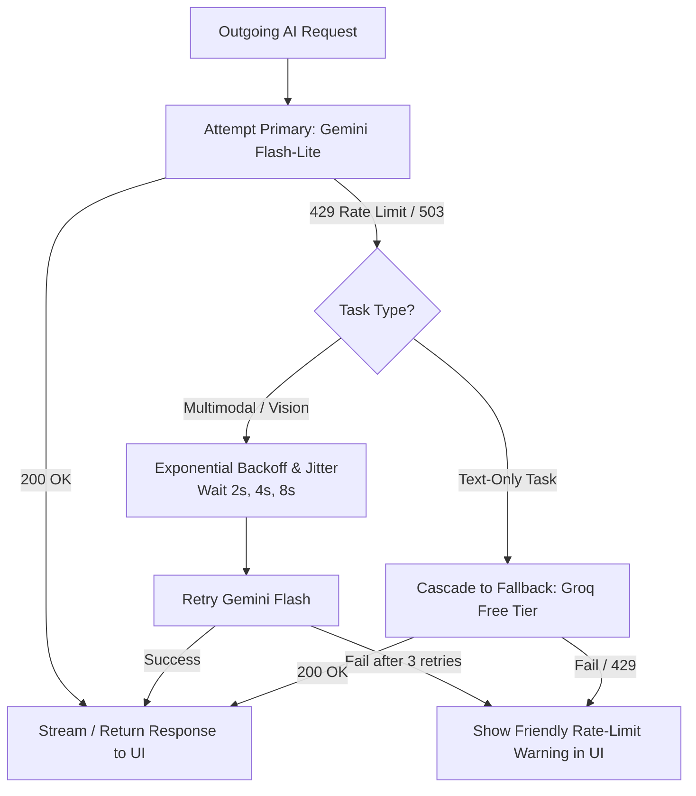
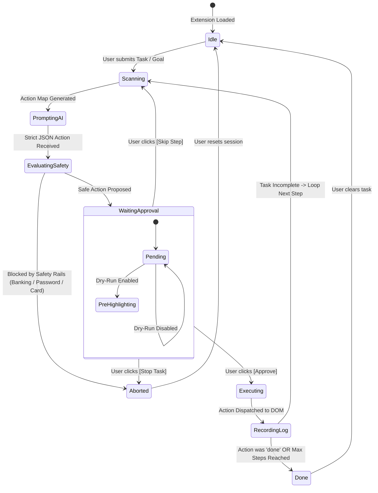
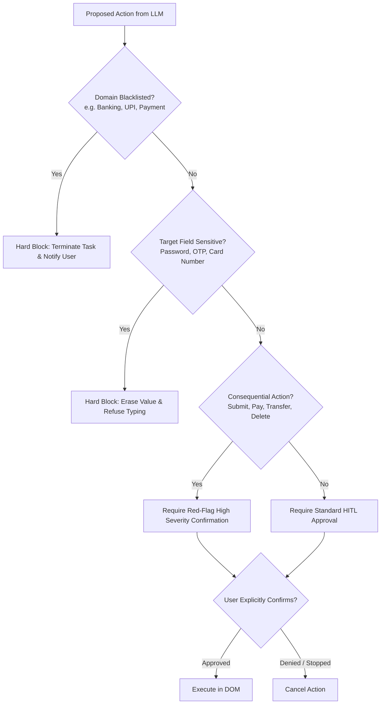
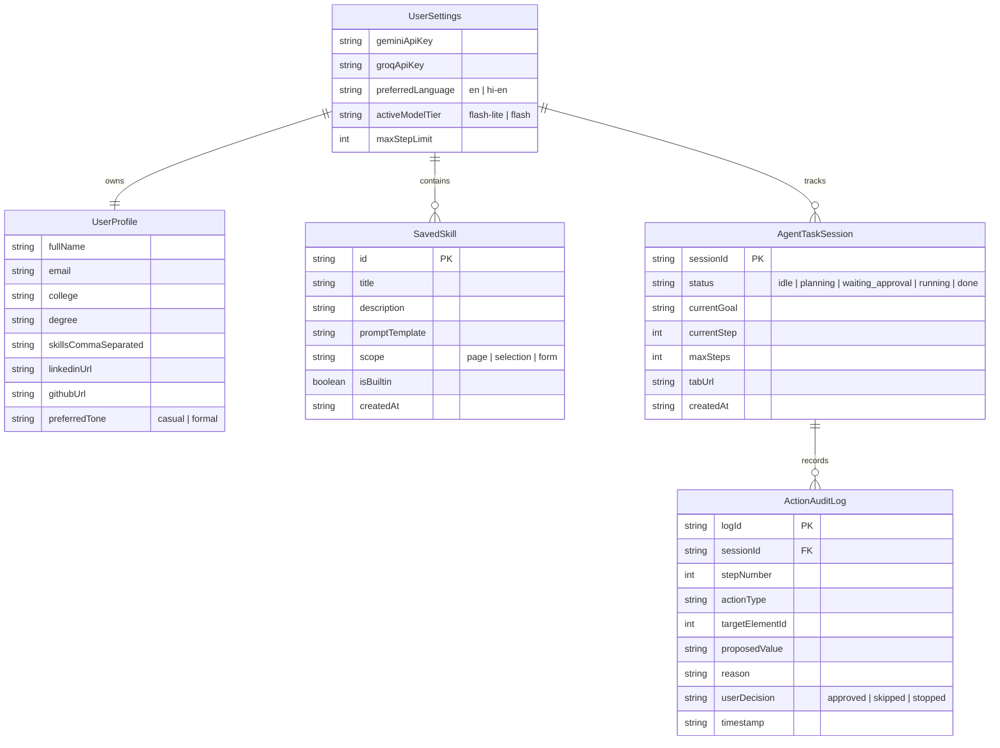

# Sahayak Architecture & Technical Specification

> **A User-Controlled, Context-Aware Browser Agent for Google Chrome (Manifest V3)**  
> _Read, Explain, See, Remember, and Act — With Explicit Human Approval at Every Step._

---

## 1. System Vision & Architectural Philosophy

**Sahayak** (सहायक — _Assistant/Companion_) is designed to bridge the gap between AI comprehension and user-controlled browser execution. Existing assistants isolate the user in an external chat window, while autonomous browser agents pose severe privacy and financial risks due to unconstrained execution.

Sahayak operates on five architectural pillars:

1. **Human-In-The-Loop (HITL) Execution**: Zero autonomous side-effects. The AI reasons, proposes a single atomic action (click, type, select, scroll), and halts. Execution proceeds _only_ after explicit user approval in the Side Panel.
2. **Context-Grounded Cognition**: Responses derive strictly from the active page context (DOM, extracted article text, or captured viewport pixels) with strict anti-hallucination protocols.
3. **Deterministic Safety Rails**: Security rules (e.g., blocking banking domains, suppressing password/OTP inputs, requiring double-confirmation for consequential triggers) are hardcoded into the extension runtime, independent of the LLM's prompt adherence.
4. **Resilient Multi-Tier AI Routing**: Defaults to low-latency, low-cost models (**Gemini 1.5/2.0 Flash-Lite**), elevates to multimodal engines (**Gemini Flash**) for visual/complex tasks, and cascades to free-tier text fallbacks (**Groq Llama-3**) during API rate-limits (HTTP 429).
5. **Zero-Telemetry Local Privacy**: API keys, user profiles, prompt recipes, and task states reside exclusively in `chrome.storage.local`. No external proxy servers or intermediate logging databases are employed.

---

## 2. High-Level Architecture Diagram



---

## 3. Chrome Extension Subsystem Breakdown

### 3.1. Manifest V3 Configuration (`manifest.json`)

The extension enforces least-privilege permissions adhering strictly to Chrome Web Store Manifest V3 guidelines:

```json
{
  "manifest_version": 3,
  "name": "Sahayak - User-Controlled Browser Agent",
  "version": "1.0.0",
  "description": "Context-aware AI side-panel assistant that reads, explains, and acts under strict human approval.",
  "permissions": ["sidePanel", "activeTab", "scripting", "storage", "contextMenus"],
  "host_permissions": ["<all_urls>"],
  "background": {
    "service_worker": "src/background/index.ts",
    "type": "module"
  },
  "side_panel": {
    "default_path": "src/sidepanel/index.html"
  },
  "action": {
    "default_title": "Open Sahayak Side Panel",
    "default_icon": {
      "16": "icons/icon-16.png",
      "48": "icons/icon-48.png",
      "128": "icons/icon-128.png"
    }
  },
  "icons": {
    "16": "icons/icon-16.png",
    "48": "icons/icon-48.png",
    "128": "icons/icon-128.png"
  },
  "content_scripts": [
    {
      "matches": ["<all_urls>"],
      "js": ["src/content/index.ts"],
      "run_at": "document_idle"
    }
  ],
  "web_accessible_resources": [
    {
      "resources": ["assets/*", "badges.css"],
      "matches": ["<all_urls>"]
    }
  ]
}
```

---

### 3.2. Side Panel Interface (Presentation Layer)

The UI runs within Chrome's native Side Panel window (`chrome.sidePanel`), sharing the viewport horizontally with any web page.

#### UI Views & Components

1. **Header Bar**:
   - Status Indicator (Idle, Planning, Awaiting Approval, Executing, Error).
   - Language Toggle: `EN` (English) vs `HI-EN` (Hinglish).
   - Active Tab Sync Badge (shows current domain and connection health).
2. **Main Workspace View (Tabbed)**:
   - **Tab 1: Read & Chat**:
     - Quick Action Pills: _Summarise Page_, _Chapter Notes (YouTube)_, _Capture & Ask_.
     - Conversation Thread: Grounded Q&A with message attribution and streaming markdown renderer.
   - **Tab 2: Agent Errands**:
     - Natural language goal input (_e.g., "Fill the internship application on this page"_).
     - **Action Map Visualizer Toggle**: Turn on/off numbered badge overlay on the page.
     - **HITL Proposed Action Card**:
       - Step index & progress counter (_e.g., "Step 3 of 10"_).
       - Action Badge (`CLICK`, `TYPE`, `SELECT`, `SCROLL`, `FINISH`).
       - Target visual snippet, element label, and value preview.
       - Model Rationale: One-line concise explanation.
       - Consequential Action Warning (red highlight if target is "Submit", "Pay", "Delete").
       - **Action Bar**: `[✓ Approve & Run]` `[↷ Skip Step]` `[✕ Stop Task]`.
       - Dry-Run Checkbox: Pre-highlights the target on the active tab without executing.
     - Action Audit Log: Expandable timeline of all past proposals and user decisions.
   - **Tab 3: Memory & Skills**:
     - Profile Management (Name, College, Skills, Links, Preferred Tone).
     - Saved Skills library (Search, Run 1-Click, Add New Recipe).
     - Skill Import / Export (`.json`).
   - **Tab 4: Settings & Diagnostics**:
     - Gemini API Key & Groq API Key inputs (masked, validated with ping check).
     - Model selector (Default Flash-Lite, Override to Flash).
     - Max Step Limit configuration (Default: 15).
     - Local Cache Flush & Safety Rule Status.

---

### 3.3. Background Service Worker (Orchestration & State Engine)

Manifest V3 Service Workers are transient and terminate after ~30 seconds of inactivity. The Service Worker architecture must be strictly stateless in memory, persisting all mutable state in `chrome.storage.local`.

#### Core Responsibilities

- **Lifecycle Management**: Restores in-flight agent sessions and pending approvals upon worker spin-up.
- **Port Hub**: Manages long-lived communication ports (`chrome.runtime.Port`) with the Side Panel to enable bidirectional message streaming.
- **AI Gateway Client**: Executes HTTPS calls to Gemini and Groq APIs directly from the extension background origin, circumventing web page CORS restrictions.
- **Context Menus Dispatcher**: Listens to `chrome.contextMenus.onClicked` events (`Explain`, `Translate`, `Draft Reply`), captures active selections, opens the Side Panel (`chrome.sidePanel.open`), and dispatches prompt workflows.
- **Visual Capture Engine**: Invokes `chrome.tabs.captureVisibleTab` on the focused window, encodes raw PNG data, and delivers it to the multimodal API.



---

### 3.4. Content Script Architecture (Active Page Interaction)

Injected at `document_idle` on `<all_urls>`, the content script exposes modular sub-controllers:

#### 1. Article Content Extractor (`ReadabilityReader`)

- Clones `document.cloneNode(true)` to avoid altering active DOM state.
- Injects Mozilla's `Readability.js` engine to parse semantic article body, strip navigation, ads, headers, and footers.
- Sanitizes output using `DOMPurify` to eliminate cross-site scripting (XSS) vectors.
- Calculates rough token counts and generates text chunks for LLM consumption.

#### 2. Interactive Element Scanner (`ElementScanner`)

- Scans visible, interactive DOM nodes matching the selector matrix:
  ```css
  a[href], button, input:not([type="hidden"]), select, textarea,
  [role="button"], [role="link"], [role="checkbox"], [role="menuitem"],
  [tabindex]:not([tabindex="-1"]), [contenteditable="true"]
  ```
- **Visibility & Pruning Filters**:
  - Excludes nodes where `getComputedStyle(el)` has `display: none`, `visibility: hidden`, `opacity: 0`.
  - Excludes nodes collapsed to zero width/height (`rect.width === 0 || rect.height === 0`).
  - Excludes nodes outside current viewport or scrolled out (annotated with viewport coordinates).
  - Checks if an element is obscured by modal overlays via `document.elementFromPoint(x, y)`.
- Assigns a stable, zero-indexed `actionId` to each valid candidate.
- Computes element attributes: tag, `id`, `name`, `type`, `placeholder`, `aria-label`, visible text snippet (up to 60 chars), bounding rectangle `{ top, left, width, height }`.

#### 3. Shadow DOM Numbered Badge Overlay (`BadgeOverlay`)

- Creates an isolated root container attached to `document.documentElement`:
  ```typescript
  const host = document.createElement('sahayak-overlay-host');
  const shadow = host.attachShadow({ mode: 'closed' });
  ```
- Renders lightweight floating numbered badges positioned absolutely over the detected coordinates.
- Isolation prevents host website styles (e.g., CSS resets, z-index wars, `!important` declarations) from breaking badge rendering, and prevents extension styles from polluting the host page.

#### 4. Synthetic Action Executor (`ActionExecutor`)

- Interacts with modern single-page apps (React, Vue, Angular, Svelte) that rely on synthetic event listeners.
- **Click**:
  ```typescript
  el.scrollIntoView({ behavior: 'smooth', block: 'center' });
  el.focus();
  el.dispatchEvent(new MouseEvent('mousedown', { bubbles: true }));
  el.dispatchEvent(new MouseEvent('mouseup', { bubbles: true }));
  el.click();
  ```
- **Type**:
  ```typescript
  el.focus();
  // Support React controlled inputs by targeting prototype value setter
  const prototype = Object.getPrototypeOf(el);
  const nativeValueSetter = Object.getOwnPropertyDescriptor(prototype, 'value')?.set;
  if (nativeValueSetter) {
    nativeValueSetter.call(el, value);
  } else {
    el.value = value;
  }
  el.dispatchEvent(new Event('input', { bubbles: true }));
  el.dispatchEvent(new Event('change', { bubbles: true }));
  ```
- **Select**: Sets selected index, fires `change` event.
- **Scroll**: Uses `window.scrollBy({ top, behavior: 'smooth' })`.

---

## 4. Multi-Tier AI Gateway & Fallback Architecture

### 4.1. Model Routing Matrix

| Workload                            | Primary Provider & Model                           | Fallback Provider & Model           | Context Strategy                                        |
| :---------------------------------- | :------------------------------------------------- | :---------------------------------- | :------------------------------------------------------ |
| **Article / Page Summaries**        | Gemini Flash-Lite (`gemini-2.0-flash-lite`)        | Groq (`llama-3.3-70b-versatile`)    | Extracted Readability Markdown (Max 12k tokens)         |
| **YouTube Summarisation**           | Gemini Flash (`gemini-2.0-flash` with YouTube URL) | Transcript API + Gemini Flash-Lite  | Ingestion via Google Native Video URL / Transcript text |
| **Grounded Page Chat**              | Gemini Flash-Lite (`gemini-2.0-flash-lite`)        | Groq (`llama-3.1-8b-instant`)       | Clean DOM excerpt + rolling 6-turn history              |
| **Screenshot-and-Ask**              | Gemini Flash (`gemini-2.0-flash`)                  | _No Fallback (Requires Multimodal)_ | Base64 PNG image + User prompt                          |
| **Element Finder (Find It For Me)** | Gemini Flash-Lite (`gemini-2.0-flash-lite`)        | Groq (`llama-3.3-70b-versatile`)    | Compact JSON Action Map                                 |
| **Single-Step Agent Loop**          | Gemini Flash-Lite (`gemini-2.0-flash-lite`)        | Groq (`llama-3.3-70b-versatile`)    | Compact JSON Action Map + User Profile + Goal           |

---

### 4.2. Free-Tier Resilience & Circuit Breaker Engine

To prevent application crashes when encountering Google AI Studio or Groq rate limits (HTTP 429 / 503):



#### Resilience Algorithms:

1. **Backoff Formula**: $T_{\text{wait}} = \min(T_{\text{max}}, T_{\text{base}} \times 2^{\text{attempt}}) \pm \text{jitter}$ (where $T_{\text{base}} = 1.5\text{s}$, $T_{\text{max}} = 10\text{s}$, jitter $\in [0, 500\text{ms}]$).
2. **Dynamic Context Pruning**: If context exceeds model limits, content scripts truncate DOM nodes beyond viewport before dispatch.
3. **Graceful Error States**: Displays actionable UI toasts (_"Gemini is busy. Automatically switched to fallback engine"_ or _"Quota exceeded. Please wait 30s"_).

---

### 4.3. YouTube Summarisation Pipeline

For YouTube URLs (`youtube.com/watch?v=...` or `youtu.be/...`):

1. **Tier A (Native Multimodal Analysis)**: Gemini 2.0 Flash supports direct YouTube video parsing via Google AI Studio API for public links. The request passes the YouTube URI directly.
2. **Tier B (Transcript Ingestion Fallback)**:
   - When direct URL parsing is blocked or quota-restricted, the extension background script fetches public subtitle tracks via YouTube TimedText API or DOM scraping.
   - Subtitles are formatted into timestamped paragraphs: `[01:24] Introduction to topic...`
   - Prompt synthesizes chapter-style notes with clickable markdown links (`[01:24](https://youtu.be/...&t=84)`), allowing users to jump directly to specific video moments.

---

## 5. Human-In-The-Loop Agent Execution Engine

### 5.1. Compact Action Map Specification

To keep token usage negligible and prevent model confusion, the raw DOM (often 500k+ characters) is converted into a concise JSON payload:

```json
{
  "page": {
    "title": "Application Form - TechCorp Internships",
    "url": "https://example.com/apply",
    "viewport": { "width": 1280, "height": 800 }
  },
  "elements": [
    {
      "id": 1,
      "tag": "input",
      "type": "text",
      "label": "Full Name",
      "placeholder": "Enter your name",
      "current_value": ""
    },
    {
      "id": 2,
      "tag": "input",
      "type": "email",
      "label": "Email Address",
      "placeholder": "name@domain.com",
      "current_value": ""
    },
    {
      "id": 3,
      "tag": "select",
      "label": "Current Degree",
      "options": ["B.Tech", "B.Sc", "M.Tech", "Other"],
      "current_value": "B.Tech"
    },
    {
      "id": 4,
      "tag": "button",
      "type": "submit",
      "label": "Submit Application",
      "is_consequential": true
    }
  ]
}
```

---

### 5.2. Strict Next-Action JSON Schema

Gemini's `responseSchema` or structured output mode is enforced to guarantee deterministic parsing. Markdown backticks or unstructured text responses are strictly rejected.

```json
{
  "$schema": "http://json-schema.org/draft-07/schema#",
  "title": "SahayakProposedAction",
  "type": "object",
  "properties": {
    "thought": {
      "type": "string",
      "description": "Internal reasoning about current page state and overall goal."
    },
    "action_type": {
      "type": "string",
      "enum": ["click", "type", "select", "scroll", "done"]
    },
    "target_id": {
      "type": ["integer", "null"],
      "description": "The actionId corresponding to the target element in the Action Map. Null for scroll or done."
    },
    "value": {
      "type": ["string", "null"],
      "description": "Value to input for type/select actions. Null for click/scroll/done."
    },
    "scroll_direction": {
      "type": ["string", "null"],
      "enum": ["up", "down", null]
    },
    "reason": {
      "type": "string",
      "description": "User-facing concise justification shown on the approval card."
    },
    "is_terminal": {
      "type": "boolean",
      "description": "True if the task is now complete."
    }
  },
  "required": ["thought", "action_type", "target_id", "value", "reason", "is_terminal"],
  "additionalProperties": false
}
```

---

### 5.3. Agent Execution State Machine



---

## 6. Deterministic Safety & Security Architecture

Sahayak treats the LLM as an **untrusted reasoning component**. Safety rules are codified natively within TypeScript in the Background Service Worker and Content Script to ensure that model hallucination, prompt injection, or malicious websites cannot trigger prohibited actions.



### 6.1. Blacklisted Domains & Protocol Filters

The agent immediately deactivates its loop and refuses to scan elements on sensitive origins:

- **Banking & Financial Gateways**: Domains matching `*bank*`, `*paytm*`, `*razorpay*`, `*stripe*`, `*paypal*`, `*billdesk*`, `*cashfree*`, `*icicibank*`, `*hdfcbank*`, `*sbi.co.in*`.
- **UPI Protocols**: URLs matching `upi://*`.
- **Credential Auth Endpoints**: `accounts.google.com`, `login.live.com`, `appleid.apple.com`.
- **Browser Internal Schemes**: `chrome://*`, `chrome-extension://*`, `view-source:*`.

### 6.2. Sensitive Input Classifier

Content script inspection suppresses any typing action if the target matches:

- `input[type="password"]`.
- Attributes matching: `name*="pass"`, `id*="pass"`, `autocomplete*="current-password"`, `autocomplete*="new-password"`.
- OTP / 2FA patterns: `name*="otp"`, `id*="otp"`, `maxlength="6"` combined with numeric pattern matching.
- Financial heuristics: `input[autocomplete*="cc-"]`, `name*="cvv"`, `name*="card"`.
- Regular expression checking on proposed values for 16-digit credit card numbers (Luhn check) or Indian UPI PIN patterns.

### 6.3. Consequential Action Gating

If a target element has text or attributes matching `["Submit", "Pay", "Place Order", "Buy Now", "Delete", "Confirm", "Send"]`:

- The Side Panel flags the action with an animated orange/red warning badge.
- A secondary confirmation checkbox is enforced: _"This action may have irreversible consequences. Confirm to execute."_

### 6.4. Data Exfiltration Safeguards

- Extracted article texts and screenshot buffers are sent _only_ to user-configured official API endpoints (`generativelanguage.googleapis.com` or `api.groq.com`).
- No hidden telemetry or analytical pings to third-party endpoints.
- User profile data is stored on-device in `chrome.storage.local` and merged locally into prompts right before transmission.

---

## 7. Data Models & Storage Schema

Data is stored locally under Chrome's sandboxed storage engine (`chrome.storage.local`).

### 7.1. Storage Entity Relationship Diagram



### 7.2. TypeScript Interfaces (`src/types/index.ts`)

```typescript
export type LanguageMode = 'en' | 'hi-en';
export type ModelTier = 'flash-lite' | 'flash' | 'groq-fallback';
export type ActionType = 'click' | 'type' | 'select' | 'scroll' | 'done';
export type TaskStatus =
  | 'idle'
  | 'scanning'
  | 'planning'
  | 'waiting_approval'
  | 'executing'
  | 'done'
  | 'aborted'
  | 'error';

export interface UserSettings {
  geminiApiKey: string;
  groqApiKey?: string;
  preferredLanguage: LanguageMode;
  activeModelTier: ModelTier;
  maxStepLimit: number;
}

export interface UserProfile {
  fullName: string;
  email: string;
  phone?: string;
  college?: string;
  degree?: string;
  skills: string[];
  linkedinUrl?: string;
  githubUrl?: string;
  portfolioUrl?: string;
  preferredTone: 'formal' | 'casual' | 'concise';
}

export interface SavedSkill {
  id: string;
  title: string;
  description: string;
  promptTemplate: string;
  category: 'summary' | 'draft' | 'form' | 'explain';
  isBuiltin: boolean;
  createdAt: string;
}

export interface ScannedElement {
  actionId: number;
  tagName: string;
  elementType?: string;
  label: string;
  currentValue?: string;
  placeholder?: string;
  options?: string[];
  isConsequential: boolean;
  boundingBox: {
    top: number;
    left: number;
    width: number;
    height: number;
  };
}

export interface ProposedAction {
  stepIndex: number;
  thought: string;
  actionType: ActionType;
  targetId: number | null;
  value: string | null;
  scrollDirection?: 'up' | 'down' | null;
  reason: string;
  isConsequential: boolean;
  isTerminal: boolean;
}

export interface ActionLogEntry {
  step: number;
  proposedAction: ProposedAction;
  decision: 'approved' | 'skipped' | 'stopped';
  timestamp: string;
  error?: string;
}
```

---

## 8. Directory Structure & Technology Stack

### 8.1. Technology Choices

- **Language**: TypeScript 5.5+ (Strict mode enabled, zero `any` policy).
- **Frontend Framework**: React 18 + Vite + `@crxjs/vite-plugin` (Fast-refresh, instant MV3 bundling).
- **Styling**: Tailwind CSS + Lucide Icons (Compact, high-density side panel design).
- **State Management**: Zustand with `persist` middleware configured for `chrome.storage.local`.
- **Parsing & Extraction**: `@mozilla/readability` + `dompurify`.
- **Validation**: `zod` for validating all LLM JSON outputs and user inputs.
- **Testing**: Vitest for unit tests; Playwright / JSDOM for synthetic browser DOM tests.

### 8.2. Source Code Organization

```
sahayak/
├── manifest.json                  # Manifest V3 entrypoint
├── package.json                   # Dependencies & scripts
├── vite.config.ts                 # CRXJS + React + Tailwind build config
├── tsconfig.json                  # TypeScript compiler options
├── tailwind.config.js             # Styling tokens
│
├── src/
│   ├── background/                # Service Worker Subsystem
│   │   ├── index.ts               # SW entrypoint & message hub
│   │   ├── orchestrator.ts        # Agent loop state machine
│   │   ├── contextMenus.ts        # Right-click action registrations
│   │   ├── safetyEngine.ts        # Deterministic security rules
│   │   └── tabCapture.ts          # Screenshot capture utilities
│   │
│   ├── content/                   # Injected Tab Scripts
│   │   ├── index.ts               # Content script entrypoint
│   │   ├── readabilityReader.ts   # Article content extractor
│   │   ├── elementScanner.ts      # Interactive node scanner & coordinate builder
│   │   ├── badgeOverlay.ts        # Shadow DOM numbered badge renderer
│   │   └── actionExecutor.ts      # Synthetic DOM event dispatcher
│   │
│   ├── sidepanel/                 # React UI Subsystem
│   │   ├── index.html             # Panel HTML root
│   │   ├── index.tsx              # React mounting root
│   │   ├── App.tsx                # App shell & navigation tabs
│   │   ├── components/            # UI Components
│   │   │   ├── Header.tsx         # Connection status & language toggle
│   │   │   ├── ChatTab.tsx        # Grounded page chat & streaming
│   │   │   ├── SummaryTab.tsx     # Article & YouTube structured summaries
│   │   │   ├── AgentTab.tsx       # HITL approval card, step controls & logs
│   │   │   ├── ProfileTab.tsx     # Local user memory editor
│   │   │   ├── SkillsTab.tsx      # Saved 1-click recipes & import/export
│   │   │   ├── SettingsTab.tsx    # API key config & diagnostic pings
│   │   │   └── ActionCard.tsx     # The critical Approve/Skip/Stop card
│   │   └── store/                 # Reactive Client State
│   │       ├── useAgentStore.ts   # Agent loop state
│   │       ├── useProfileStore.ts # User profile memory
│   │       └── useSettingsStore.ts# API keys & language preferences
│   │
│   ├── services/                  # AI Gateway & Business Logic
│   │   ├── geminiClient.ts        # Gemini Flash-Lite & Flash client
│   │   ├── groqClient.ts          # Groq fallback client
│   │   ├── router.ts              # Resilient cascade router & rate-limit handler
│   │   ├── prompts.ts             # System instructions & Hinglish prompt builder
│   │   └── youtubeService.ts      # Public YouTube parsing & chapter extraction
│   │
│   ├── types/                     # Shared TypeScript declarations
│   │   └── index.ts               # Interfaces, enums & Zod schemas
│   │
│   └── utils/                     # Helpers
│       ├── storage.ts             # Typed chrome.storage wrapper
│       ├── domUtils.ts            # Viewport calculation & coordinates
│       └── formatters.ts          # Markdown & timestamp formatting
│
├── public/                        # Static assets
│   ├── icons/                     # Extension icons (16, 48, 128px)
│   └── mock/                      # Mock HTML pages for practice errands
│       ├── internship-form.html   # Practice application form
│       └── e-commerce-filter.html # Practice catalog with filters
│
└── tests/                         # Test Suite
    ├── safetyEngine.test.ts       # Test URL/password blocking
    ├── elementScanner.test.ts     # Test coordinate & selector logic
    └── actionExecutor.test.ts     # Test synthetic input triggers
```

---

## 9. Four-Week Implementation Roadmap

Following the project requirements, development is structured into four sequential, testable vertical slices.

### Week 1 — "The Eyes": Read the Web & Foundational Chrome Shell

#### Primary Objectives:

Establish the Manifest V3 architecture, launch the Side Panel, implement API key persistence, and enable grounded article/YouTube summarisation in English and Hinglish.

#### Execution Tasks:

1. **Repository & Build Setup**: Initialize Vite + `@crxjs/vite-plugin` with TypeScript and Tailwind CSS.
2. **Manifest V3 Foundation**: Configure `manifest.json`, side panel permissions, service worker, and basic icon assets. Verify installation via **Load unpacked**.
3. **Settings & API Client**: Implement `SettingsTab` to persist `geminiApiKey` into `chrome.storage.local`. Build `geminiClient.ts` with ping validation.
4. **Article Content Extraction**: Integrate Mozilla `Readability.js` and `DOMPurify` into content script. Transmit sanitized article text to background worker.
5. **Structured Summarisation Prompting**:
   - Deliver structured schema: _One-line TL;DR_, _5 key points_, _What to do next_.
   - Implement Language Switcher: Toggle between English and natural Hinglish (_e.g., "Yeh article explain karta hai kaise AI productivity badha sakta hai..."_).
6. **Public YouTube Summarisation**: Parse YouTube video ID from URL. Pass public link directly to Gemini Flash or scrape captions to generate timestamped chapter notes.

#### Week 1 Deliverables & Verification:

- Side Panel opens alongside any standard webpage.
- User enters API key in UI settings without hardcoding.
- Right-click or button press summarises medium/news articles and public YouTube links into the 3-part structured format.
- Output switches smoothly between English and Hinglish.

---

### Week 2 — "The Brain": Grounded Page Chat & Visual Understanding

#### Primary Objectives:

Transform the side panel into a conversational assistant that answers strictly from page context, handles right-click contextual shortcuts, supports screen capture Q&A, and survives free-tier rate limits.

#### Execution Tasks:

1. **Grounded Page Chat**:
   - Ingest extracted page content into conversation prompt.
   - Enforce strict negative constraints: _"If the page does not explicitly state the answer, reply: 'This information is not present on the current page.' Do not hallucinate."_
   - Stream responses into the Side Panel via Server-Sent Events (SSE) or chunked port messages.
2. **Context Menu Actions**: Register `chrome.contextMenus`:
   - `Explain this`: Rewrites highlighted text in simple terms.
   - `Translate`: Translates selected text into Hindi/English.
   - `Draft a reply`: Ingests email/post snippet and drafts a contextual reply.
   - Clicking an action automatically opens the Side Panel and initiates the request.
3. **Screenshot-and-Ask**:
   - Trigger `chrome.tabs.captureVisibleTab`.
   - Provide an optional crop/focus UI inside the side panel.
   - Dispatch base64 image to Gemini Flash with user prompt (_"What is this chart showing?"_ or _"Explain this error dialog"_).
4. **Free-Tier Resilience & Fallback Engine**:
   - Intercept HTTP 429 status codes.
   - Implement exponential retry with jitter.
   - Connect Groq client (`llama-3.3-70b`) as a fallback provider for text tasks when Gemini quotas are saturated.

#### Week 2 Deliverables & Verification:

- User can chat with page content with verified zero-hallucination guardrails.
- Right-click actions route selected snippets directly into side-panel generation.
- Visible charts and diagrams can be queried via screen capture.
- Graceful error states and automatic fallback trigger during rate limits.

---

### Week 3 — "The Hands": Controlled Action with Human Approval

#### Primary Objectives:

Equip Sahayak with browser automation capabilities using an interactive element scanner, numbered badge overlay, strict JSON action proposals, and human approval gating.

#### Execution Tasks:

1. **Interactive Element Scanner**:
   - Implement `elementScanner.ts` to locate buttons, links, inputs, dropdowns, and checkboxes.
   - Filter hidden or occluded nodes; compute viewport bounding boxes.
2. **Shadow DOM Badge Overlay**:
   - Attach `#sahayak-overlay-host` to page DOM.
   - Render high-contrast numbered badges over candidate elements without conflicting with site styles.
3. **Structured "Find It For Me"**:
   - User asks: _"Where is the upload resume button?"_
   - Model returns JSON: `{ "target_id": 12, "reason": "Found file input with label 'Upload Resume'" }`.
   - Element 12 scrolls into view and pulses with an animated ring.
4. **Agent Action Loop & HITL Approval UI**:
   - Package compact Action Map into prompt.
   - Request single next action via strict JSON schema.
   - Display `ActionCard` in Side Panel with proposed action, target preview, and one-line rationale.
   - Await user button press: `Approve & Run`, `Skip`, or `Stop`.
   - Execute approved action via `actionExecutor.ts` (synthetic focus, value setter, input/change events).
5. **Agent Controls & Persistence**:
   - Implement Dry-Run mode (highlights element on tab without clicking/typing).
   - Enforce `maxStepLimit` (default: 15 steps).
   - Store session progress in `chrome.storage.local` to survive service worker deactivation.
   - Record and display full action audit log.
6. **Controlled Practice Scenarios**:
   - Validate end-to-end against `public/mock/internship-form.html` (multi-field form filling) and `e-commerce-filter.html` (search & filter).

#### Week 3 Deliverables & Verification:

- Numbered badges appear cleanly over interactable elements.
- The assistant identifies correct elements from natural language instructions.
- Next actions are rendered in structured JSON and halt for user decision.
- No DOM action fires without clicking **Approve**.
- Multi-step practice form completes with step-by-step human confirmation.

---

### Week 4 — "Memory, Safety, & Shipping": Polish, Hardening, & Distribution

#### Primary Objectives:

Implement local user memory, custom prompt recipes, enforce deterministic security rules, package the extension, and prepare distribution artifacts.

#### Execution Tasks:

1. **Local Profile Memory**:
   - Create `ProfileTab` allowing users to save their details (Name, College, Degree, Skills, Links).
   - Automatically inject profile context into form-filling and reply-drafting workflows.
2. **One-Click Saved Skills**:
   - Build a library of reusable prompt recipes (_"Exam Notes"_, _"Explain in Hinglish"_, _"Fill Form from Profile"_).
   - Implement JSON Import and Export to share skills across devices.
3. **Hardcoded Safety Rails**:
   - Enforce domain blacklist (block banking, payments, UPI).
   - Enforce sensitive field blocker (refuse typing into password, OTP, CVV, and credit card fields).
   - Implement double-confirmation dialog for consequential buttons (_"Submit"_, _"Pay"_, _"Delete"_).
   - Add immediate red Emergency Stop button in the side panel header.
4. **Production Packaging & Release**:
   - Build optimized production bundle via `pnpm build`.
   - Generate `sahayak-v1.0.0.zip` suitable for installation via **Load unpacked**.
   - Create comprehensive `README.md` with visual architecture diagrams, setup guide, and feature walkthrough.
   - Create a static landing page in `docs/` ready for deployment on GitHub Pages.

#### Week 4 Deliverables & Verification:

- Form fields populate accurately from local user profile memory.
- Custom skills can be created, run, exported, and imported.
- Sensitive fields (password, OTP, payment) are blocked deterministically by code.
- Consequential buttons trigger high-severity confirmation.
- Extension builds cleanly, packages into a standalone ZIP, and loads without warnings on clean Chrome profiles.

---

## 10. Verification, Testing & Quality Assurance Plan

### 10.1. Unit & Schema Verification

- **JSON Schema Strictness**: Test `zod` schema validator against malformed LLM outputs to verify that broken JSON triggers a re-prompt rather than an application crash.
- **Safety Engine Rules**:
  ```typescript
  // Example Vitest test case
  test('SafetyEngine blocks typing into password fields', () => {
    const sensitiveElement: ScannedElement = {
      actionId: 1,
      tagName: 'input',
      elementType: 'password',
      label: 'Enter Password',
      isConsequential: false,
      boundingBox: { top: 0, left: 0, width: 100, height: 30 },
    };
    expect(SafetyEngine.isFieldSafeToType(sensitiveElement)).toBe(false);
  });
  ```

### 10.2. Synthetic Browser Integration Testing

Using mock HTML fixtures in `public/mock/`:

1. **Form Automation Test (`internship-form.html`)**:
   - Load form with text, email, select dropdown, and submit button.
   - Run task: _"Fill this form using my profile"_.
   - Verify that Sahayak pauses at each step: `Step 1 (Name) -> Approve -> Step 2 (Email) -> Approve -> Step 3 (Degree) -> Approve -> Step 4 (Submit - Flagged Consequential) -> Extra Confirm -> Done`.
2. **Dry-Run Mode Test**:
   - Enable dry-run checkbox.
   - Approve a click action on a navigation link.
   - Verify that the target receives visual highlight styling, but the page URL remains unchanged.

### 10.3. Chaos & Fault-Tolerance Testing

- **Service Worker Sleep**: Force service worker shutdown via `chrome://serviceworker-internals` while waiting on an approval step. Verify that reopening the side panel recovers the pending approval card seamlessly from `chrome.storage.local`.
- **Network Rate Limit Simulation**: Mock API responses returning HTTP 429 with `Retry-After: 3`. Verify that exponential backoff initiates and the user sees a non-blocking toast.

---

## 11. Security & Compliance Checklist

- [x] **Manifest V3 Compliant**: Uses Service Worker and Side Panel API; zero remote scripts (`script-src 'self'`).
- [x] **Zero Hardcoded Secrets**: All API keys supplied by end-user and stored strictly in `chrome.storage.local`.
- [x] **No Intermediate Telemetry**: Direct client-to-API network calls only; no third-party logging or proxy backend.
- [x] **Deterministic Safety Gates**: Code-level prevention of password, OTP, and banking automation.
- [x] **Human Confirmation Gating**: Zero background execution without an active approval click.
- [x] **DOM Sanitization**: All extracted content and rendered markdown scrubbed via `DOMPurify`.
- [x] **Isolated Overlay**: Badges rendered in Closed Shadow DOM to prevent host page style or script leakage.
