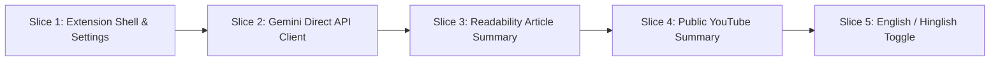
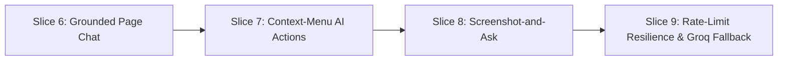
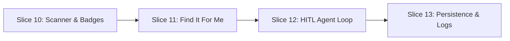
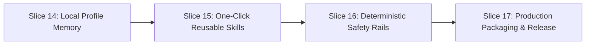

# Sahayak: Phase-Wise Implementation Plan

> **Project**: Sahayak — User-Controlled, Context-Aware Browser Agent  
> **Target**: Google Chrome Extension (Manifest V3)  
> **Duration**: 4 Weeks | 4 Core Phases | 17 Vertical Slices  
> **Development Tooling**: Cursor IDE + TypeScript + React 18 + Vite (`@crxjs/vite-plugin`) + Tailwind CSS

---

## Table of Contents

1. [Implementation Strategy & Guiding Principles](#1-implementation-strategy--guiding-principles)
2. [Project Setup & Baseline Architecture (Day 0)](#2-project-setup--baseline-architecture-day-0)
3. [Phase 1: Foundation & "The Eyes" (Week 1)](#3-phase-1-foundation--the-eyes-week-1)
   - [Slice 1: Extension Shell, Side Panel & Settings](#slice-1-extension-shell-side-panel--settings)
   - [Slice 2: Gemini Direct API Client & Text Call](#slice-2-gemini-direct-api-client--text-call)
   - [Slice 3: Article Extraction & Structured Summaries](#slice-3-article-extraction--structured-summaries)
   - [Slice 4: Public YouTube Video Summarisation](#slice-4-public-youtube-video-summarisation)
   - [Slice 5: English & Hinglish Language Engine](#slice-5-english--hinglish-language-engine)
4. [Phase 2: Cognition, Vision & Resilience (Week 2)](#4-phase-2-cognition-vision--resilience-week-2)
   - [Slice 6: Grounded Page Chat with Streaming](#slice-6-grounded-page-chat-with-streaming)
   - [Slice 7: Context-Menu AI Actions](#slice-7-context-menu-ai-actions)
   - [Slice 8: Screenshot-and-Ask (Multimodal Vision)](#slice-8-screenshot-and-ask-multimodal-vision)
   - [Slice 9: Rate-Limit Resilience & Groq Fallback Cascade](#slice-9-rate-limit-resilience--groq-fallback-cascade)
5. [Phase 3: "The Hands" — Action Map & Human Approval Loop (Week 3)](#5-phase-3-the-hands--action-map--human-approval-loop-week-3)
   - [Slice 10: Interactive Element Scanner & Shadow DOM Badges](#slice-10-interactive-element-scanner--shadow-dom-badges)
   - [Slice 11: Structured Element Selection ("Find It For Me")](#slice-11-structured-element-selection-find-it-for-me)
   - [Slice 12: Single-Step Agent Loop & HITL Approval UI](#slice-12-single-step-agent-loop--hitl-approval-ui)
   - [Slice 13: Progress Persistence, Dry-Run Mode & Action Logs](#slice-13-progress-persistence-dry-run-mode--action-logs)
6. [Phase 4: Memory, Deterministic Safety & Shipping (Week 4)](#6-phase-4-memory-deterministic-safety--shipping-week-4)
   - [Slice 14: Local Profile Memory](#slice-14-local-profile-memory)
   - [Slice 15: One-Click Reusable Skills & JSON Import/Export](#slice-15-one-click-reusable-skills--json-importexport)
   - [Slice 16: Deterministic Safety Rails & Consequential Gating](#slice-16-deterministic-safety-rails--consequential-gating)
   - [Slice 17: Production Packaging, Release ZIP & Landing Page](#slice-17-production-packaging-release-zip--landing-page)
7. [Comprehensive Verification & Testing Matrix](#7-comprehensive-verification--testing-matrix)

---

## 1. Implementation Strategy & Guiding Principles

To ensure successful delivery within the 4-week window without regressions:

1. **Vertical Slices Over Horizontal Layers**: Each slice produces a complete, testable capability spanning UI, background worker, content script, and AI integration before moving to the next.
2. **Deterministic Security Over Model Trust**: Never rely on system prompts alone to prevent hazardous actions. Safety checks run locally in TypeScript before dispatching any DOM mutation.
3. **Stateless Service Worker Discipline**: Background workers in MV3 terminate after ~30 seconds of inactivity. All in-flight agent sessions and approvals must be synchronized with `chrome.storage.local`.
4. **Zero-Telemetry Local Privacy**: API keys, user profiles, prompt recipes, and task history must reside exclusively on the user's local device.

---

## 2. Project Setup & Baseline Architecture (Day 0)

### 2.1. Tooling & Dependencies Initialization

#### Directory Structure Initialization

```bash
mkdir -p sahayak/src/{background,content,sidepanel,services,types,utils}
mkdir -p sahayak/public/{icons,mock}
mkdir -p sahayak/tests
```

#### Dependencies Configuration (`package.json`)

```json
{
  "name": "sahayak-extension",
  "version": "1.0.0",
  "private": true,
  "type": "module",
  "scripts": {
    "dev": "vite",
    "build": "tsc && vite build",
    "preview": "vite preview",
    "test": "vitest run"
  },
  "dependencies": {
    "@mozilla/readability": "^0.5.0",
    "clsx": "^2.1.1",
    "dompurify": "^3.2.4",
    "lucide-react": "^0.475.0",
    "react": "^18.3.1",
    "react-dom": "^18.3.1",
    "tailwind-merge": "^3.0.1",
    "zod": "^3.24.2",
    "zustand": "^5.0.3"
  },
  "devDependencies": {
    "@crxjs/vite-plugin": "^2.0.0-beta.28",
    "@types/chrome": "^0.0.306",
    "@types/dompurify": "^3.2.0",
    "@types/node": "^22.13.4",
    "@types/react": "^18.3.18",
    "@types/react-dom": "^18.3.5",
    "@vitejs/plugin-react": "^4.3.4",
    "autoprefixer": "^10.4.20",
    "postcss": "^8.5.2",
    "tailwindcss": "^3.4.17",
    "typescript": "^5.7.3",
    "vite": "^6.1.0",
    "vitest": "^3.0.5"
  }
}
```

#### Vite & CRXJS Configuration (`vite.config.ts`)

```typescript
import { defineConfig } from 'vite';
import react from '@vitejs/plugin-react';
import { crx } from '@crxjs/vite-plugin';
import manifest from './manifest.json';
import path from 'path';

export default defineConfig({
  plugins: [react(), crx({ manifest })],
  resolve: {
    alias: {
      '@': path.resolve(__dirname, './src'),
    },
  },
  build: {
    rollupOptions: {
      input: {
        sidepanel: 'src/sidepanel/index.html',
      },
    },
  },
});
```

---

## 3. Phase 1: Foundation & "The Eyes" (Week 1)



### Slice 1: Extension Shell, Side Panel & Settings

- **Goal**: Establish the Manifest V3 structure, register the Side Panel, implement persistent API settings, and verify the extension loads unpacked in Google Chrome.
- **Files Created/Modified**:
  - `manifest.json`
  - `src/sidepanel/index.html`
  - `src/sidepanel/index.tsx`
  - `src/sidepanel/App.tsx`
  - `src/sidepanel/components/Header.tsx`
  - `src/sidepanel/components/SettingsTab.tsx`
  - `src/utils/storage.ts`
- **Implementation Steps**:
  1. Define Manifest V3 with `sidePanel`, `storage`, and `activeTab` permissions.
  2. Implement `src/utils/storage.ts` with strongly typed wrappers around `chrome.storage.local.get` and `set`.
  3. Create `SettingsTab.tsx` with a masked input for `geminiApiKey`, API key validation ping, and preferred language setting.
  4. Implement an automatic trigger in `background/index.ts` to open the side panel when the user clicks the extension action icon (`chrome.sidePanel.setPanelBehavior({ openPanelOnActionClick: true })`).
- **Cursor Implementation Prompt**:
  > "Create the Manifest V3 configuration and React Side Panel shell for Sahayak. Configure the CRXJS plugin, add chrome.sidePanel.setPanelBehavior in the background script to open on icon click, and build a settings view with an API key input that securely saves and validates the Gemini API key in chrome.storage.local."
- **Acceptance Criteria**:
  - Extension loads in `chrome://extensions` via **Load unpacked** without manifest warnings.
  - Clicking the toolbar icon opens the Side Panel on any standard tab.
  - Entering and saving an API key persists across browser restarts.

---

### Slice 2: Gemini Direct API Client & Text Call

- **Goal**: Construct a robust client to invoke Google AI Studio's Gemini REST API directly from the extension runtime without intermediary servers.
- **Files Created/Modified**:
  - `src/services/geminiClient.ts`
  - `src/types/api.ts`
  - `src/sidepanel/components/QuickExplain.tsx`
- **Implementation Steps**:
  1. Implement `geminiClient.ts` targeting `https://generativelanguage.googleapis.com/v1beta/models/gemini-2.0-flash-lite:generateContent`.
  2. Implement proper authorization header or `?key=` query parameter using the key stored in `chrome.storage.local`.
  3. Implement error handling for invalid keys (HTTP 400), expired keys (HTTP 403), and rate limits (HTTP 429).
  4. Create a "Test Connection" button in the Settings tab that makes a minimal generation request (`"Respond with 'OK'"`) and displays connection latency.
- **Acceptance Criteria**:
  - Valid API key test returns status `200 OK` and renders a green indicator.
  - Invalid API key displays a descriptive error message guiding the user to Google AI Studio.

---

### Slice 3: Article Extraction & Structured Summaries

- **Goal**: Extract readable article content from the active tab and produce a structured three-part summary (TL;DR, 5 Key Points, Next Steps).
- **Files Created/Modified**:
  - `src/content/readabilityReader.ts`
  - `src/content/index.ts`
  - `src/services/prompts.ts`
  - `src/sidepanel/components/SummaryTab.tsx`
- **Implementation Steps**:
  1. In `src/content/readabilityReader.ts`, clone the DOM and execute Mozilla's `@mozilla/readability`.
  2. Sanitize extracted text with `DOMPurify` to eliminate malicious scripts.
  3. Send an extraction message (`GET_ARTICLE_CONTENT`) from the Side Panel through the background worker to the active tab.
  4. In `src/services/prompts.ts`, author the summary prompt enforcing output in strict markdown structure:
     - `### TL;DR (One-Line Summary)`
     - `### 5 Key Takeaways`
     - `### Recommended Next Steps`
  5. Render the result with streaming typography in `SummaryTab.tsx`.
- **Cursor Implementation Prompt**:
  > "Implement the content extraction and summarisation pipeline. In the content script, use @mozilla/readability on a cloned DOM to parse clean article text. In the side panel, create a 'Summarise Page' button that fetches this extracted text, passes it to Gemini Flash-Lite with a structured 3-part summary prompt, and renders the output in markdown."
- **Acceptance Criteria**:
  - Cluttered web pages (e.g., Wikipedia, Substack, Medium) are stripped of navigation, ads, and footers.
  - Output strictly adheres to the 3-section layout.

---

### Slice 4: Public YouTube Video Summarisation

- **Goal**: Generate structured chapter summaries with clickable timestamps for supported public YouTube links.
- **Files Created/Modified**:
  - `src/services/youtubeService.ts`
  - `src/utils/urlUtils.ts`
  - `src/sidepanel/components/YouTubeSummaryCard.tsx`
- **Implementation Steps**:
  1. In `urlUtils.ts`, extract the 11-character video ID from YouTube URLs (`youtube.com/watch?v=ID` or `youtu.be/ID`).
  2. If on a YouTube tab, pass the video URL or ID to `gemini-2.0-flash`, which natively ingests public YouTube video contents.
  3. Include a fallback: If direct URL parsing is unavailable, fetch caption tracks from YouTube's public TimedText endpoint and compile timestamps into readable text blocks.
  4. Prompt the model to generate chapter-style summaries with markdown timestamps: `[MM:SS](https://youtu.be/VIDEO_ID?t=SECONDS)`.
  5. When a timestamp link is clicked in the side panel, use `chrome.tabs.update` to seek the video in the active tab without page reload.
- **Acceptance Criteria**:
  - Public YouTube videos are detected automatically when opening the Summary tab.
  - Timestamps are clickable and navigate the player in the active tab to the specified time.

---

### Slice 5: English & Hinglish Language Engine

- **Goal**: Implement seamless output switching between standard English and conversational Hinglish across all AI capabilities.
- **Files Created/Modified**:
  - `src/services/prompts.ts`
  - `src/sidepanel/components/Header.tsx`
  - `src/sidepanel/store/useSettingsStore.ts`
- **Implementation Steps**:
  1. Define the Hinglish system prompt directive:
     > _"You must communicate in natural, conversational Hinglish (Hindi written in the Latin alphabet). Blend English technical terminology with Hindi phrasing naturally (e.g., 'Yeh article explain karta hai ki neural networks kaise train hote hain. Sabse pehla step data preprocessing hai...'). Do not use Devanagari script."_
  2. Add an interactive segmented control toggle (`EN` / `HI-EN`) in the Side Panel header.
  3. Dynamically inject the appropriate language directive into all summarisation, chat, and explanation requests.
- **Acceptance Criteria**:
  - Toggling to `HI-EN` converts summaries and chat outputs to fluent Hinglish without breaking code snippets or links.
  - The language preference is preserved in `chrome.storage.local`.

---

## 4. Phase 2: Cognition, Vision & Resilience (Week 2)



### Slice 6: Grounded Page Chat with Streaming

- **Goal**: Implement a context-aware chat interface grounded strictly in the active page's text, rejecting unmentioned facts and streaming responses chunk-by-chunk.
- **Files Created/Modified**:
  - `src/sidepanel/components/ChatTab.tsx`
  - `src/sidepanel/components/ChatMessage.tsx`
  - `src/sidepanel/store/useChatStore.ts`
  - `src/services/geminiClient.ts`
- **Implementation Steps**:
  1. Add streaming support in `geminiClient.ts` using `fetch` with `ReadableStream` decoding Server-Sent Events (SSE).
  2. When opening a chat session, extract the readable page text and inject it into the system prompt:
     > _"You are Sahayak. Answer user questions using ONLY the provided Page Context. If the answer is not contained in the context, explicitly respond: 'This information is not present on the current page.' Do not hallucinate or use outside knowledge."_
  3. Store the conversation history (last 6 turns) in local state, pruning older turns to conserve tokens.
  4. Stream tokens directly into `ChatTab.tsx` with smooth scrolling.
- **Acceptance Criteria**:
  - Questions answerable from the page return accurate citations and excerpts.
  - Questions about unmentioned topics trigger the grounded refusal response.
  - Stream begins rendering within 800ms of user submission.

---

### Slice 7: Context-Menu AI Actions

- **Goal**: Add right-click menu items for selected text that automatically open the Side Panel and trigger Explain, Translate, or Draft Reply.
- **Files Created/Modified**:
  - `src/background/contextMenus.ts`
  - `src/background/index.ts`
  - `src/sidepanel/store/useChatStore.ts`
- **Implementation Steps**:
  1. In `src/background/contextMenus.ts`, register menu items on `chrome.runtime.onInstalled`:
     - `sahayak-explain`: "Explain this with Sahayak"
     - `sahayak-translate`: "Translate with Sahayak"
     - `sahayak-draft`: "Draft a reply with Sahayak"
  2. In `chrome.contextMenus.onClicked`, capture `info.selectionText` and open the side panel via `chrome.sidePanel.open({ windowId })`.
  3. Dispatch the action type and selected text through a background-to-sidepanel message channel.
  4. Automatically populate the chat thread and trigger the corresponding prompt.
- **Acceptance Criteria**:
  - Right-clicking highlighted text displays all 3 Sahayak actions.
  - Clicking any action opens the Side Panel and displays the generated result.

---

### Slice 8: Screenshot-and-Ask (Multimodal Vision)

- **Goal**: Enable users to capture the visible browser tab and query charts, error messages, and diagrams using Gemini Flash multimodal capabilities.
- **Files Created/Modified**:
  - `src/background/tabCapture.ts`
  - `src/sidepanel/components/ScreenshotModal.tsx`
  - `src/services/geminiClient.ts`
- **Implementation Steps**:
  1. Implement `tabCapture.ts` calling `chrome.tabs.captureVisibleTab(null, { format: 'png' })`.
  2. Send the resulting base64 data URL to the Side Panel.
  3. Render an image preview modal in the Side Panel with an optional crop rectangle selector.
  4. Encode the image into Gemini's `inlineData` format (`image/png`) and dispatch to `gemini-2.0-flash` with the user's prompt.
  5. Display the vision response with the thumbnail of the captured region attached.
- **Acceptance Criteria**:
  - Captures visible screen content without requiring full-page scrolling permissions.
  - Correctly answers questions regarding data points on charts or visual error alerts.

---

### Slice 9: Rate-Limit Resilience & Groq Fallback Cascade

- **Goal**: Gracefully intercept API failures and rate limits (HTTP 429), automatically retrying with exponential backoff and cascading to Groq free-tier Llama-3 for text tasks.
- **Files Created/Modified**:
  - `src/services/groqClient.ts`
  - `src/services/router.ts`
  - `src/sidepanel/components/SettingsTab.tsx`
- **Implementation Steps**:
  1. Add an optional Groq API Key input in `SettingsTab.tsx`.
  2. Implement `groqClient.ts` targeting `https://api.groq.com/openai/v1/chat/completions` using `llama-3.3-70b-versatile`.
  3. Build `router.ts` wrapping all LLM requests with:
     - HTTP 429 & 503 detection.
     - Jittered exponential backoff: $T = \min(10\text{s}, 1.5\text{s} \times 2^{\text{attempt}}) \pm 300\text{ms}$.
     - Automatic cascade: If Gemini text fails after 2 retries and a Groq key is present, route the prompt to Groq.
  4. Display a subtle badge in the UI when running on the fallback provider: _"Switched to Groq Fallback"_.
- **Acceptance Criteria**:
  - Simulated HTTP 429 errors trigger automatic retry without user intervention.
  - Exceeded Gemini quotas fall back seamlessly to Groq on text tasks without UI crashes.

---

## 5. Phase 3: "The Hands" — Action Map & Human Approval Loop (Week 3)



### Slice 10: Interactive Element Scanner & Shadow DOM Badges

- **Goal**: Identify interactive elements on the active page, build a structured Action Map, and render non-invasive numbered badges over the elements using an isolated Shadow DOM.
- **Files Created/Modified**:
  - `src/content/elementScanner.ts`
  - `src/content/badgeOverlay.ts`
  - `src/types/agent.ts`
- **Implementation Steps**:
  1. In `elementScanner.ts`, scan candidates: `button`, `a[href]`, `input`, `select`, `textarea`, `[role="button"]`, `[contenteditable]`.
  2. Filter out invisible elements (`rect.width === 0`, `display: none`, `visibility: hidden`, or opacity 0).
  3. Assign each element an incrementing `actionId` (1, 2, 3...) and compile metadata (tag, type, label, placeholder, coordinates).
  4. In `badgeOverlay.ts`, create `#sahayak-overlay-host` and attach a closed Shadow DOM.
  5. Render high-contrast badges (`[1]`, `[2]`, `[3]`) positioned absolutely above each element's bounding box.
  6. Add a toggle in the Side Panel to show or hide the overlay badges at any time.
- **Acceptance Criteria**:
  - Badges render accurately on buttons, inputs, and links without shifting host page layouts.
  - Hidden elements (e.g., hidden dropdown options, off-screen drawers) are excluded from the scan.

---

### Slice 11: Structured Element Selection ("Find It For Me")

- **Goal**: Enable natural-language element queries (_"Where do I enter my email?"_), returning strict JSON to highlight and scroll the target element into view without clicking.
- **Files Created/Modified**:
  - `src/content/actionExecutor.ts`
  - `src/sidepanel/components/AgentTab.tsx`
  - `src/services/prompts.ts`
- **Implementation Steps**:
  1. Build a prompt containing the compact Action Map and the user's element query.
  2. Enforce strict JSON output schema: `{ "target_id": number, "reason": string }`.
  3. Send message `HIGHLIGHT_ELEMENT` to the content script with `target_id`.
  4. In `actionExecutor.ts`, scroll the element into view with smooth behavior and apply an animated pulsing highlight ring.
- **Acceptance Criteria**:
  - Natural language queries identify the correct element number with >95% accuracy on test forms.
  - The target element smoothly scrolls into view and pulses visually.

---

### Slice 12: Single-Step Agent Loop & HITL Approval UI

- **Goal**: Implement the core one-step-at-a-time agent execution loop, requiring user approval before dispatching synthetic clicks, typing, or selection events.
- **Files Created/Modified**:
  - `src/background/orchestrator.ts`
  - `src/content/actionExecutor.ts`
  - `src/sidepanel/components/ActionCard.tsx`
  - `src/sidepanel/store/useAgentStore.ts`
- **Implementation Steps**:
  1. In `orchestrator.ts`, implement the step sequence:
     `Scan Page -> Build Action Map -> Prompt Gemini -> Receive Strict JSON -> Halt & Propose Action`.
  2. Implement the `ActionCard.tsx` component in the Side Panel:
     - Displays action type (`CLICK`, `TYPE`, `SELECT`, `SCROLL`, `DONE`).
     - Target label preview, proposed text value, and one-line reason.
     - Controls: **[Approve & Run]**, **[Skip Step]**, **[Stop Task]**.
  3. When **Approve** is clicked, dispatch `EXECUTE_ACTION` to `actionExecutor.ts`:
     - `click`: Triggers `mousedown`, `mouseup`, and native `.click()`.
     - `type`: Overrides prototype value setters to trigger React/Vue synthetic events, firing `input` and `change`.
     - `select`: Sets option value and fires `change`.
     - `scroll`: Calls `window.scrollBy`.
  4. Wait 500ms for DOM stabilization, re-scan elements, and repeat the loop until `done` or stopped.
- **Acceptance Criteria**:
  - The extension never executes an action without the user explicitly clicking **Approve**.
  - Clicking **Skip** asks the AI to propose an alternate step without mutating the DOM.
  - Clicking **Stop** immediately cancels the execution loop.

---

### Slice 13: Progress Persistence, Dry-Run Mode & Action Logs

- **Goal**: Ensure the agent loop survives service worker deactivation, supports non-destructive dry-run previews, enforces a maximum step limit, and maintains a complete audit log.
- **Files Created/Modified**:
  - `src/background/orchestrator.ts`
  - `src/sidepanel/components/ActionLogViewer.tsx`
  - `src/sidepanel/store/useAgentStore.ts`
- **Implementation Steps**:
  1. Synchronize agent state (`currentStep`, `maxSteps`, `activeGoal`, `pendingAction`) to `chrome.storage.local` after every transition.
  2. When the service worker awakens, rehydrate active state and re-render the pending `ActionCard`.
  3. Add a **Dry-Run Mode** checkbox:
     - When checked, approving an action highlights the target element in blue without dispatching click or type events.
  4. Enforce `maxStepLimit` (configurable in settings, default: 15). Abort gracefully when the threshold is reached.
  5. Log every proposed action, reason, user decision, and timestamp into `ActionLogViewer.tsx`.
- **Acceptance Criteria**:
  - Manually terminating the background worker via `chrome://serviceworker-internals` does not corrupt or lose the pending action.
  - Dry-run mode previews the target element without altering form state or triggering navigation.
  - Tasks halt immediately when reaching the step limit.

---

## 6. Phase 4: Memory, Deterministic Safety & Shipping (Week 4)



### Slice 14: Local Profile Memory [Completed]

- **Goal**: Provide an on-device personal profile and preferences memory system that extracts, stores, retrieves, and injects user context into Page Chat, Summaries, and Agent Planning with zero silent collection and strict human-in-the-loop approval.
- **Files Created/Modified**:
  - `src/features/memory/types/memory.types.ts`
  - `src/features/memory/schemas/memory.schema.ts`
  - `src/features/memory/services/memory-storage.service.ts`
  - `src/features/memory/services/memory-extraction.service.ts`
  - `src/features/memory/services/memory-retrieval.service.ts`
  - `src/features/memory/services/memory.service.ts`
  - `src/features/memory/hooks/useMemory.ts`
  - `src/features/memory/hooks/useMemorySettings.ts`
  - `src/features/memory/components/MemoryCard.tsx`
  - `src/features/memory/components/MemoryEditor.tsx`
  - `src/features/memory/components/MemoryApprovalCard.tsx`
  - `src/features/memory/components/MemorySettingsView.tsx`
  - `src/features/memory/components/MemoryDashboard.tsx`
  - `src/features/memory/index.ts`
  - `tests/memory.test.ts`
- **Implementation Highlights**:
  1. Built multi-category taxonomy (`preferences`, `personal_profile`, `work_context`, `language_preferences`, `interaction_preferences`, `custom`).
  2. Natural language memory instruction detection in English & Romanized Hinglish with conflict/update diff proposals and forget/delete detection.
  3. Strict zero-silent tracking: sensitive credential rejection (Gemini/Groq keys, tokens, credit cards, passwords).
  4. Context retrieval scoring and prompt injection with untrusted `<user_context>` boundaries and explicit user instruction override guarantee.
  5. Full dedicated Memory dashboard in Side Panel with search, category filtering, manual entry/editing, and export/import portability.
- **Acceptance Criteria**:
  - Profile memories remain strictly on-device in `chrome.storage.local` (`sahayak_profile_memories_v1`).
  - Stored preferences personalize AI interactions across Page Chat, Summarization, and Agent Planning.
  - Active user instructions in prompts always take precedence over saved background memories.

---

### Slice 15: One-Click Reusable Skills & JSON Import/Export (Completed)

- **Goal**: Enable users to save, customize, execute, import, and export reusable multi-modal AI workflows called Skills across all Sahayak features with safe templating and complete on-device privacy.
- **Files Created/Modified**:
  - `src/features/skills/types/skill.types.ts`: Strongly typed schemas for skills, categories, parameter types, execution routes, history records, and portable JSON packages.
  - `src/features/skills/schemas/skill.schema.ts`: Strict Zod validation schemas for all skill definitions, parameters, execution records, and export packages with bounds enforcement.
  - `src/features/skills/data/builtin-skills.ts`: 8 predefined immutable built-in skills spanning summarization, research, writing, navigation, and page interaction.
  - `src/features/skills/utils/skill-compatibility.ts`: Context compatibility engine matching skills against active browser tab URL, article structure, YouTube presence, and text selection.
  - `src/features/skills/services/skill-template.service.ts`: Safe non-eval variable extraction, default resolution, parameter validation, and HTML sanitization.
  - `src/features/skills/services/skill-storage.service.ts`: On-device storage in `chrome.storage.local` (`sahayak_user_skills_v1`, `sahayak_builtin_skill_prefs_v1`) with immutability guarantees for built-in skills.
  - `src/features/skills/services/skill-history.service.ts`: Execution history persistence (`sahayak_skill_history_v1`) with automatic pruning up to 100 entries.
  - `src/features/skills/services/skill-export.service.ts`: Portable versioned JSON exporter with zero credential/memory leakage guarantees.
  - `src/features/skills/services/skill-import.service.ts`: Safe JSON parser with schema validation, collision detection (rename/overwrite), and file size safety limits.
  - `src/features/skills/services/skill-execution.service.ts`: Feature routing facade directing skills to Article Summaries, YouTube Summaries, Page Chat, Find Element, Rewrite, and Agent Actions under HITL approval.
  - `src/features/skills/services/skill.service.ts`: Unified orchestration facade.
  - `src/features/skills/hooks/`: React hooks `useSkills.ts`, `useSkillExecution.ts`, `useSkillHistory.ts`.
  - `src/features/skills/components/`: Complete UI suite with `SkillsDashboard.tsx`, `SkillCard.tsx`, `SkillInputForm.tsx`, `SkillEditor.tsx`, `SkillExecutionResult.tsx`, `SkillImportDialog.tsx`, `SkillExportDialog.tsx`, and `SkillExecutionHistory.tsx`.
  - `src/features/skills/SkillsPage.tsx`: Integrated Skills dashboard top-level page.
  - `src/features/skills/index.ts`: Barrel export.
  - `tests/skills.test.ts`: 36 comprehensive unit and integration tests covering all aspects of Slice 15.
- **Implementation Highlights**:
  1. Built multi-category taxonomy (`summarization`, `research`, `productivity`, `writing`, `navigation`, `page_interaction`, `custom`).
  2. Built-in vs. user-created immutability: Built-in skills cannot be edited or deleted directly; users can duplicate them to create customizable copies or toggle favorite/enabled preferences.
  3. Safe template engine using `{{var}}` placeholders with variable extraction, required/optional parameter validation, default values, and zero dynamic code execution (`eval`/`Function`).
  4. Routing integration: Seamlessly triggers existing capabilities (Slice 3 Article Summaries, Slice 4 YouTube Summaries, Slice 6 Grounded Page Chat, Slice 11 Find Element, Rewrite, and Slice 12 Single-Step Agent Loop with HITL approval and Slice 13 Dry-Run compliance).
  5. Privacy-preserving JSON export & import: Packages skills into versioned `sahayak-skills` JSON while strictly excluding API keys, credentials, profile memories, and execution logs.
  6. Execution history logging completely isolated from agent action logs and profile memories.
- **Acceptance Criteria**:
  - Built-in and custom skills trigger their respective workflows with a single click.
  - All 8 built-in skills remain immutable while permitting preference overrides and custom duplication.
  - Interactive element and browser actions strictly route through the Slice 12 HITL approval loop.
  - Exported JSON files import cleanly into fresh installations with duplicate/collision resolution (rename/overwrite).
  - All 36 test cases in `tests/skills.test.ts` pass, and the full 345-test suite passes with 0 regressions.

---

### Slice 16: Deterministic Safety Rails & Consequential Gating (Completed)

- **Goal**: Enforce deterministic, code-level safety boundaries that prevent actions on banking sites, block password/OTP typing, strictly block consequential triggers (form submission, payments, financial transfers, messaging, publishing, destructive operations, credential updates), and require double-confirmation for elevated risk.
- **Files Created/Modified**:
  - `src/features/safety/types/safety.types.ts`: Strongly-typed risk levels, policy decisions, blocked categories, safety rules, and audit models.
  - `src/features/safety/schemas/safety-policy.schema.ts`: Zod validation schemas for safety policies and decisions.
  - `src/features/safety/rules/default-safety-rules.ts`: Immutable declarations of 9 mandatory blocked categories and default safety rules.
  - `src/features/safety/services/url-safety.service.ts`: Protocol whitelist (HTTP/HTTPS only), embedded credential detection, and URL validation.
  - `src/features/safety/services/consequential-action.service.ts`: English and Romanized Hinglish keyword pattern matching and consequential classification.
  - `src/features/safety/services/action-risk.service.ts`: Deterministic risk calculation (`low`, `medium`, `high`, `critical`) ignoring model claims.
  - `src/features/safety/services/safety-policy.service.ts`: Central policy evaluation engine with immutable mandatory rule enforcement.
  - `src/features/safety/services/execution-guard.service.ts`: Pre-execution gatekeeper with replay prevention registry and fail-closed semantics.
  - `src/features/safety/services/safety-audit.service.ts`: Dedicated privacy-preserving safety audit logging in `chrome.storage.local`.
  - `src/features/safety/components/RiskIndicator.tsx`: Visual badge for risk levels.
  - `src/features/safety/components/BlockedActionNotice.tsx`: High-visibility blocked alert banner with rule justification.
  - `src/features/safety/components/EnhancedConfirmation.tsx`: Double-acknowledgement checkbox for high-risk actions.
  - `src/features/safety/components/SafetySettings.tsx`: Settings panel listing immutable rules and confirmation preferences.
  - `src/features/agent/components/AgentApprovalCard.tsx`: Integrated safety policy evaluation, blocked notices, and enhanced confirmation.
  - `src/features/agent/services/agent-orchestrator.service.ts`: Integrated deterministic policy evaluation and pre-execution guards.
  - `src/features/agent/services/agent-executor.service.ts`: Enforced execution guard verification, single-use token checks, and replay prevention.
  - `tests/safety.test.ts`: Comprehensive test suite with 30 unit and integration tests.
- **Acceptance Criteria (Verified)**:
  - Centralized policy engine deterministically calculates risk and evaluates rules entirely in TypeScript without AI delegation.
  - Consequential operations across 9 mandatory blocked categories are hard-blocked with approval controls completely disabled.
  - English and Romanized Hinglish phrasing for payments, transfers, and destructive actions are reliably identified.
  - Navigation actions to non-HTTP/HTTPS protocols (`javascript:`, `data:`, `file:`, `chrome:`) and URLs with embedded credentials are strictly blocked.
  - High-risk operations require explicit double-acknowledgement before approval can proceed.
  - Execution Guard prevents replay attacks, checks target element mutation, enforces fresh approval tokens, and allows Dry-Run simulation.
  - Zero sensitive values (passwords, OTPs, credentials) are collected or logged.
  - All 30 safety tests in `tests/safety.test.ts` pass, and all 375 tests across 21 test suites pass with 0 regressions.

---

### Slice 17: Production Packaging, Release ZIP & Landing Page (Completed)

- **Goal**: Package the extension into a production-ready ZIP distribution, generate cryptographic SHA-256 integrity verification, create comprehensive release documentation, and build a polished public-facing product landing page.
- **Files Created/Modified**:
  - `scripts/validate-extension.mjs`: Automated 8-point MV3 manifest, icon, security leak, and dev artifact validator.
  - `scripts/package-extension.mjs`: Automated packaging script generating `release/sahayak-v1.0.0.zip` and unpacked distribution.
  - `scripts/generate-checksum.mjs`: SHA-256 checksum calculator and verifier.
  - `scripts/utils/zip.mjs`: Pure Node.js standard PKZIP 2.0 archive generator with zero third-party dependencies.
  - `docs/index.html`: Modern, responsive SaaS landing page with product preview, 12 feature cards, 3-step guide, and interactive agent simulator.
  - `docs/styles.css`: Complete responsive design system with dark/light themes.
  - `docs/app.js`: Theme toggler, mobile drawer, interactive simulator, FAQ accordions, and clipboard copying.
  - `docs/assets/`: Brand logo assets (`logo.png`, `logo-dark.png`, `logo-icon.png`, icons).
  - `docs/sitemap.xml` & `docs/robots.txt`: Search engine optimization configuration.
  - `docs/INSTALLATION.md`: Step-by-step Chrome Developer mode setup and API key guide.
  - `docs/RELEASE.md`: Production checklist, packaging commands, and integrity verification procedures.
  - `docs/PRIVACY.md`: Strict zero-telemetry declaration and local credential policy.
  - `CHANGELOG.md`: Full version history spanning all 17 slices of v1.0.0.
  - `README.md`: Comprehensive documentation with Section 19 and updated build scripts table.
  - `package.json`: Added `validate:extension`, `checksum`, `package`, and `release` npm scripts.
  - `tests/release-packaging.test.ts`: 17 unit and integration tests verifying manifest compliance, security, release packaging, and landing page structure.
- **Acceptance Criteria (Verified)**:
  - Clean extraction of `release/sahayak-v1.0.0.zip` (or `release/sahayak-v1.0.0/`) installs directly into Chrome without errors.
  - Automated validator strictly prevents broken releases, missing entry points, and credential leaks.
  - SHA-256 cryptographic checksum guarantees package integrity.
  - Landing page in `docs/` is self-contained and ready for GitHub Pages or static web deployment without polluting extension bundles.
  - All 17 tests in `tests/release-packaging.test.ts` pass, and the full test suite passes with 392/392 tests across 22 test files.

---

## 7. Comprehensive Verification & Testing Matrix

| Feature Slice                | Test Scenario                     | Expected Outcome                                                   | Verification Method                |
| :--------------------------- | :-------------------------------- | :----------------------------------------------------------------- | :--------------------------------- |
| **Slice 1: Shell**           | Load unpacked in Chrome           | Extension loads with no manifest errors; opens side panel on click | Manual via `chrome://extensions`   |
| **Slice 2: Gemini Client**   | Test API key connection           | Valid key displays 200 OK latency badge; invalid key shows error   | Automated Unit Test + UI Ping      |
| **Slice 3: Readability**     | Summarise news article            | Strips ads and navigation; outputs 3-part markdown summary         | Manual on Wikipedia/Medium article |
| **Slice 4: YouTube**         | Summarise public video            | Outputs structured notes with clickable timestamps                 | Manual on YouTube video tab        |
| **Slice 5: Language**        | Switch to Hinglish                | Generates fluent Latin-script Hinglish text without Devanagari     | Prompt verification test           |
| **Slice 6: Chat**            | Ask question outside page context | Responds with refusal: _"This information is not present..."_      | Anti-hallucination unit test       |
| **Slice 7: Context Menu**    | Right-click "Explain this"        | Opens side panel with selected text explanation                    | Manual browser interaction         |
| **Slice 8: Vision**          | Screenshot chart and query        | Accurately identifies trends and visual values in image            | Vision benchmark test              |
| **Slice 9: Resilience**      | Mock HTTP 429 response            | Retries with backoff; cascades to Groq if key is present           | Vitest network mock                |
| **Slice 10: Scanner**        | Scan interactive page             | Attaches numbered badges in Shadow DOM without layout shift        | DOM fixture test                   |
| **Slice 11: Element Finder** | "Where do I upload resume?"       | Scrolls to file input and pulses animated highlight ring           | Synthetic form test                |
| **Slice 12: HITL Loop**      | Fill practice form                | Halts for user approval before each individual click or keystroke  | End-to-end on mock form            |
| **Slice 13: Persistence**    | Terminate Service Worker          | Restores pending approval step upon re-opening side panel          | `chrome://serviceworker-internals` |
| **Slice 14: Profile**        | "Fill form from profile"          | Maps name, college, and URLs to matching form fields               | Mock internship application test   |
| **Slice 15: Skills**         | Export and import skills          | Validates JSON schema and restores custom prompt recipes           | Schema validation test             |
| **Slice 16: Safety Rails**   | Trigger on payment gateway        | Instantly blocks action execution with security notification       | Hardcoded domain & field test      |
| **Slice 17: Release**        | Install from ZIP artifact         | Clean install via **Load unpacked** on fresh Chrome profile        | Final acceptance test              |
